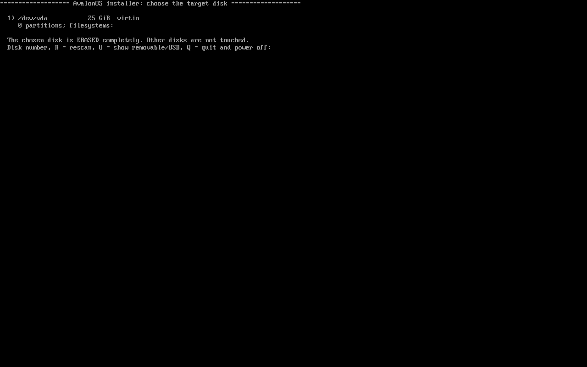
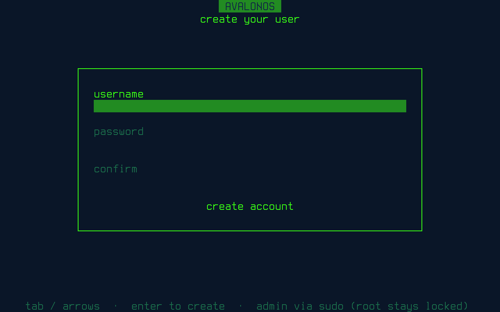

# AvalonOS

AvalonOS is a lean desktop Linux distribution from
[AvalonWave Software](https://avalonwavesoftware.com). It is built on
**Fedora 44** so you can rely on Fedora packages, and it takes some
Omarchy ideas into a smaller environment. The session is Wayland-only
and uses the **niri** compositor (scrollable tiling). The default
config is set up for people coming from i3: stock i3-style keybindings
for the terminal, launcher, closing a window, focus and move, and
numbered workspaces, plus i3-style tabbed stacking (one window visible
in a column, the others as tabs).

> [!IMPORTANT]
> **You need an internet connection to install AvalonOS.** The ISO is a net install: it downloads packages from Fedora and RPM Fusion mirrors while it installs. Plug in wired Ethernet before you start, since it's the most reliable option.



The installer disk picker. The chosen disk is erased completely; other disks are not touched.



First boot: create your user. Root stays locked; admin is via sudo.

## Features

- Fedora 44 base. Official Fedora packages, with RPM Fusion used only
  for the NVIDIA driver (`akmod-nvidia`).
- Wayland session on niri, with X11 applications through
  xwayland-satellite. Press Super+Shift+/ for the on-screen keybind
  overlay.
- i3-style default binds (Super+Return terminal, Super+D launcher,
  Super+Shift+Q close, Super+j/k/l/; or arrows to focus, Super+Shift
  plus those keys to move, Super+1…0 workspaces) and tabbed stacking.
  niri is still a scrollable-tiling compositor, not an i3 clone.
- AvalonOS RPMs and repository metadata are signed. The installer
  checks signatures during installation.
- Root is locked. The daily user is created on first boot. The SSH
  server is not installed.
- The default installer entry offers a disk picker and asks you to
  type the chosen disk's name before erasing it.
- Desktop tools include Firefox, Dolphin, Alacritty, Neovim, Waybar,
  Rofi, PipeWire, and NetworkManager with iwd. The network menu can
  also set up a Libreswan IPsec VPN with a pre-shared key or a
  certificate already in the NSS database. IKEv2 EAP
  username/password is unsupported.
- Dolphin is the file manager, picked so AvalonOS can build on KDE's
  ongoing work on network sharing.
- When a network route is up on first boot, Flathub is added and
  Obsidian is installed. An offline install still reaches login and
  gets Obsidian later. The ISO itself stays RPM-signed only.
- `bluez` and `blueman` are installed; `bluetooth.service` is disabled
  by default. Enable the unit if you want Bluetooth.
- SELinux is Enforcing.

## Get it

> [!WARNING]
> **Internet connection required.** The AvalonOS ISO is a net install: it downloads packages from Fedora and RPM Fusion mirrors while it installs, so you need a working internet connection during installation. A wired Ethernet connection is the most reliable option.

The current release is **[v0.1.0-9](https://github.com/AvalonWaveSoftware/AvalonOS/releases/tag/v0.1.0-9)**
(published 25 November 2026, 9:59 PM CT, America/Chicago).

Download these two files into the same directory:

- [AvalonOS-netinst-x86_64.iso](https://github.com/AvalonWaveSoftware/AvalonOS/releases/download/v0.1.0-9/AvalonOS-netinst-x86_64.iso)
  (about 1.24 GB)
- [AvalonOS-netinst-x86_64.iso.sha256](https://github.com/AvalonWaveSoftware/AvalonOS/releases/download/v0.1.0-9/AvalonOS-netinst-x86_64.iso.sha256)

Then verify the ISO:

```bash
sha256sum -c AvalonOS-netinst-x86_64.iso.sha256
```

The expected SHA-256 is:

```text
8d1a04a64d6e7cc178a54c6cf6b8f11e82bac4c013d40f998f7e8cf4e9dd7542
```

A checksum downloaded with the ISO detects corruption. It does not by
itself prove who published the file. The release also includes
`SHA256SUMS` and the public key `RPM-GPG-KEY-avalonos` (fingerprint
`F0AA82E5FEB779364658A18D96508B1357FDAB48`). Check that fingerprint
before importing the key.

The image is a remaster of the Fedora 44 Everything netinst ISO.
Installation needs a network connection (see the note above).

How to write the image to a USB stick (BIOS and UEFI), first login,
and troubleshooting are in [How-to-Install.md](How-to-Install.md).

## Before you install

- Connect to the internet first, wired Ethernet if you can. The
  installer can't finish without it.
- Architecture: x86_64.
- The default menu entry erases the whole disk you select after you
  type its name. Back up first. Do not use the separate
  “AUTOMATIC INSTALL - ERASES ALL DISKS” entry unless you intend to
  wipe every disk.
- If you want the NVIDIA akmod driver, turn Secure Boot off in
  firmware before installing. That driver is unsigned and will not
  load with Secure Boot enabled; otherwise the system stays on
  nouveau. Machines without an NVIDIA GPU can leave Secure Boot on.
- The desktop needs a display adapter with a render device. Basic
  adapters (for example QEMU `-vga std`) can show a “no render
  device” message instead of a desktop. In a VM, use a virtio GPU.

## Help

- [GitHub Issues](https://github.com/AvalonWaveSoftware/AvalonOS/issues)
- [AvalonWave Software](https://avalonwavesoftware.com)

On an installed system, user documentation is also copied to
`~/AvalonOS-Docs`.

## Contributing

"I dunno know, make a pull request or something man, I don't even know why you're here"

[Open a pull request](https://github.com/AvalonWaveSoftware/AvalonOS/pulls)

## License

AvalonOS is licensed under the [Apache License 2.0](LICENSE).

## Further documentation

- [How-to-Install.md](How-to-Install.md) — USB install, first login, troubleshooting
- [docs/RELEASE-NOTES.md](docs/RELEASE-NOTES.md) — release notes for v0.1.0-9
- [docs/iso.md](docs/iso.md) — installer ISO, signature checks, and rebuilds
- [docs/decisions/](docs/decisions/) — design decisions (including niri and the first-boot Obsidian exception)
- [docs/hardware.md](docs/hardware.md) — reference laptop used in development, not a minimum-spec list

This repository is the source for the netinst installer ISO. Rebuild
steps are in `docs/iso.md`.
